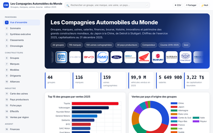

# Les Compagnies Automobiles du Monde

Application web autonome sur les constructeurs automobiles du monde entier : groupes, marques, modèles, usines, dirigeants, alliances, finances, bourse, électrification, histoire et patrimoine. Chiffres de l'exercice 2025, capitalisations au 31 décembre 2025.

🔗 Application en ligne : https://abdoulhamiddiallo.github.io/compagnies-automobiles/

## 📸 Aperçu

## 🏆 Résultats clés

- 44 groupes automobiles, 116 marques, 30 modèles les plus vendus, 159 usines cartographiées, 30 pays producteurs, 37 alliances et participations
- 160 logos officiels embarqués dans le fichier
- 28 chapitres organisés en six parties : Panorama, Constructeurs, Industrie, Argent, Analyses, Repères
- Fonctionne sans connexion : données, graphiques, cartes et logos sont dans un seul fichier HTML

## 💼 Impact métier

- Comparer en quelques secondes la taille, la rentabilité, la valeur boursière et le degré d'électrification de n'importe quel constructeur
- Comprendre la bascule de l'industrie vers la Chine : production, exportations, montée de BYD, SAIC et Geely dans le top 10
- Lire la géographie de l'industrie : où sont les usines, où vend chaque groupe, qui possède qui

## 📝 Synthèse exécutive

- Toyota reste le premier constructeur mondial pour la sixième année consécutive avec 11,32 millions de véhicules
- Trois groupes chinois figurent dans le top 10 mondial ; BYD est devenu le premier vendeur de 100 % électriques
- Tesla vaut en bourse plus que tous les autres constructeurs réunis, pour moins de 2 % des ventes
- Ferrari dégage la marge nette la plus élevée de l'industrie avec moins de 14 000 voitures par an
- Un véhicule sur quatre vendu dans le monde en 2025 est électrique ou hybride rechargeable

## 🔄 Pipeline

1. Collecte des chiffres dans les rapports annuels et communiqués des groupes, les compilations de presse spécialisée (CLS, CarNewsChina, Nikkei, Focus2Move) et les statistiques OICA
2. Structuration en tables Python : groupes, marques, modèles, usines, pays, alliances, dirigeants, répartitions régionales
3. Récupération des emblèmes officiels depuis Wikipédia et Wikimedia Commons, recadrage et compression
4. Assemblage en un fichier unique par un script de construction : données JSON, moteur de graphiques, fonds de carte Natural Earth, logos, styles et code de l'application

## 🧬 Lignage des données

| Donnée | Source | Période |
|---|---|---|
| Ventes par groupe | Rapports annuels, compilation CLS | 2015 à 2025 |
| Chiffre d'affaires, résultat net, effectifs, R&D | Comptes annuels 2025 | Exercice 2025 |
| Capitalisations boursières | Clôture du 31 décembre 2025 | 2025 |
| Production par pays | OICA et associations nationales | 2025 |
| Usines et capacités | Communiqués des constructeurs | 2025 |
| Modèles les plus vendus | Focus2Move, rapports des constructeurs | 2025 |
| Logos | Wikipédia, Wikimedia Commons | 2026 |

## 🏗️ Architecture

- Un seul fichier `index.html` d'environ 1,2 Mo, sans aucune dépendance réseau
- Données embarquées dans un objet JavaScript, rendu dynamique de toutes les sections
- Carte du monde vectorielle dessinée dans l'application (zoom, déplacement, info-bulles)
- Thème jour et nuit, affichage adapté au téléphone, recherche globale, export CSV

## 🛠️ Technologies

- HTML, CSS et JavaScript
- Chart.js pour les graphiques
- Fonds de carte Natural Earth
- Python pour la préparation des données et l'assemblage

## ✅ Conclusion

Cette application réunit dans une seule page tout ce qu'il faut pour comprendre l'industrie automobile mondiale en 2025 : qui produit, qui vend, qui gagne de l'argent, qui vaut cher en bourse, qui a basculé vers l'électrique.

## 💭 Mot de la fin

Construire pour explorer. Explorer pour comprendre. Et apprendre en chemin.

Abdoul Hamid Diallo · [LinkedIn](https://www.linkedin.com/in/abdoul-hamid-diallo-fabric-data-engineer/) · [Toutes mes applications](https://abdoulhamiddiallo.github.io/)
